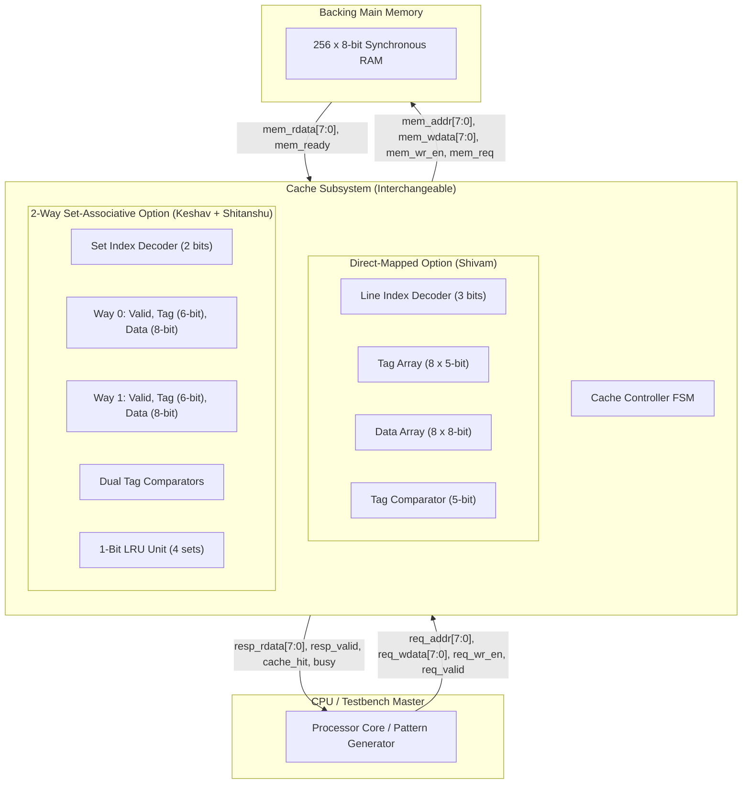
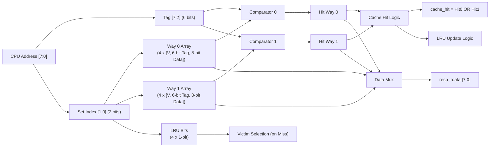
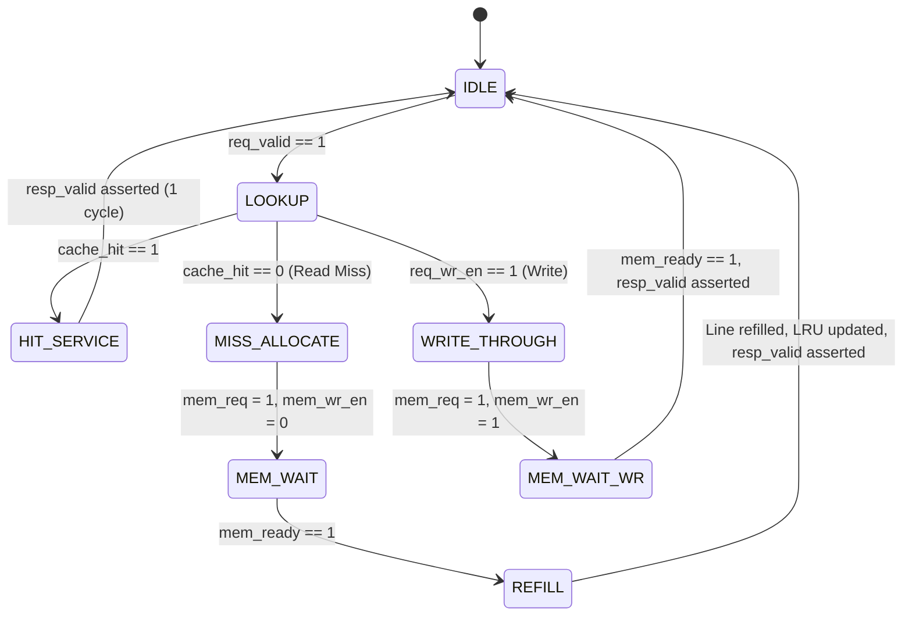
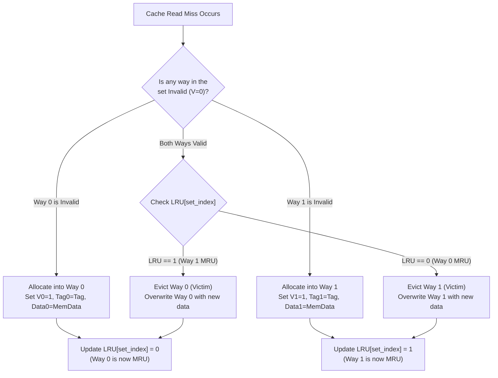

# System Architecture & Flow Diagrams

This document contains Mermaid diagrams illustrating the top-level architecture, cache internal structures, and control flow.

---

## 1. Complete System Architecture

---

## 2. Two-Way Set-Associative Cache Internal Organization

---

## 3. Cache Controller Finite State Machine (FSM)

---

## 4. LRU Replacement Logic Flow

